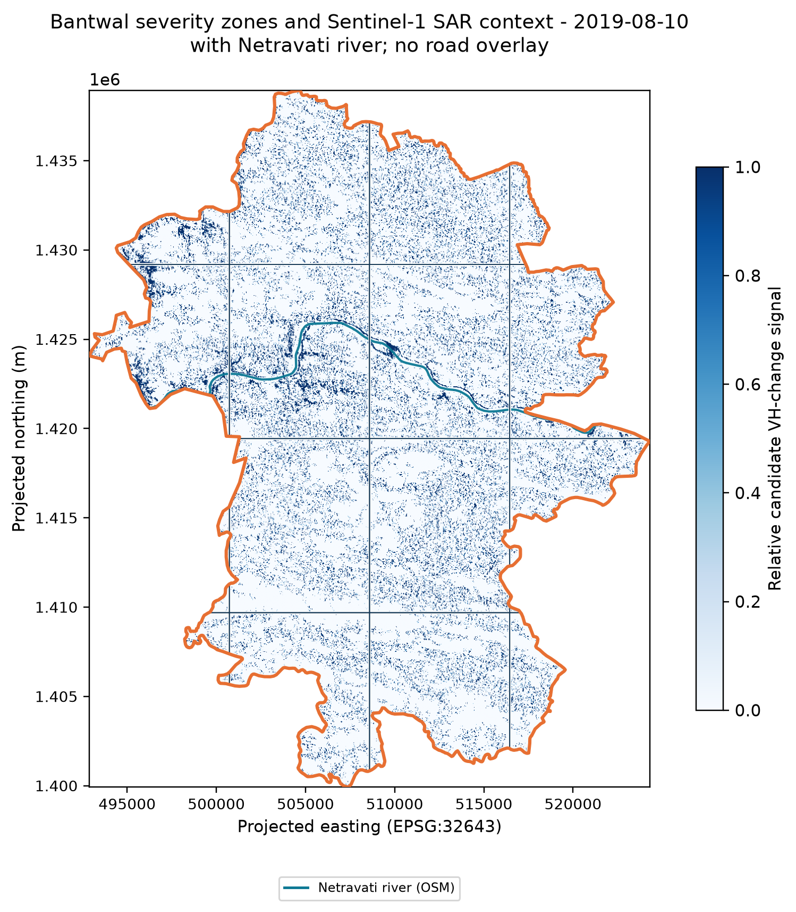
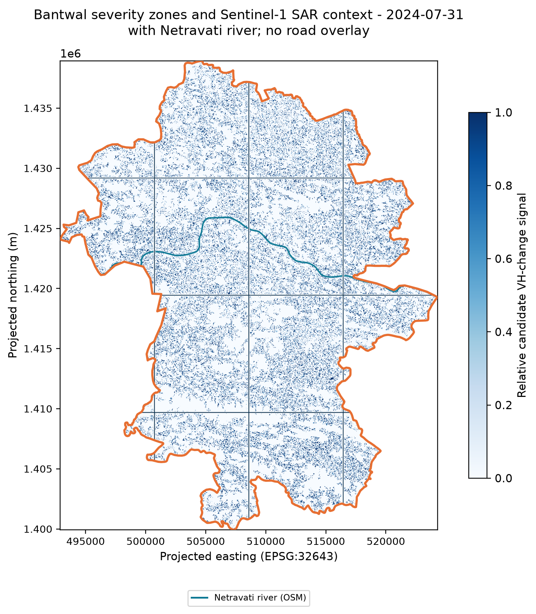
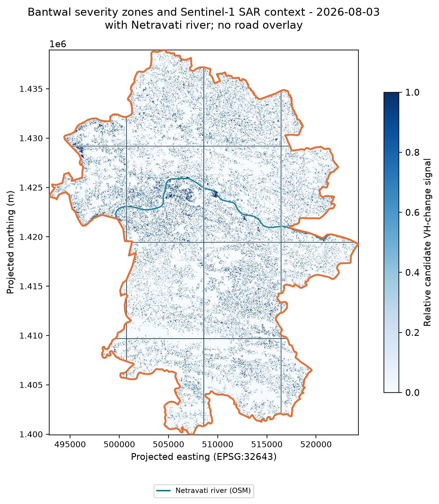
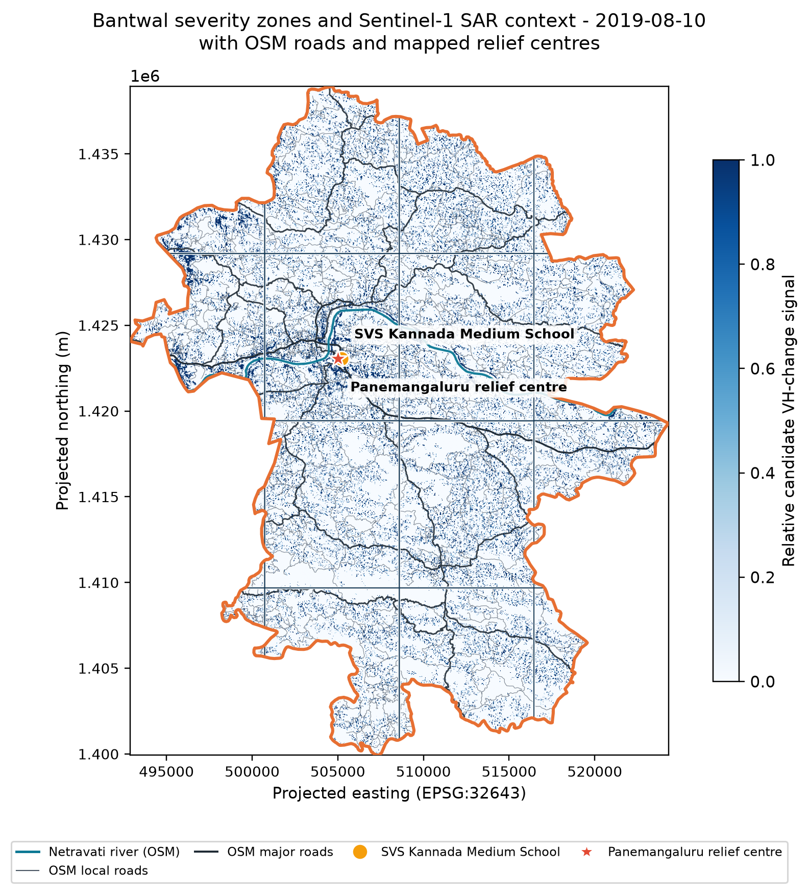
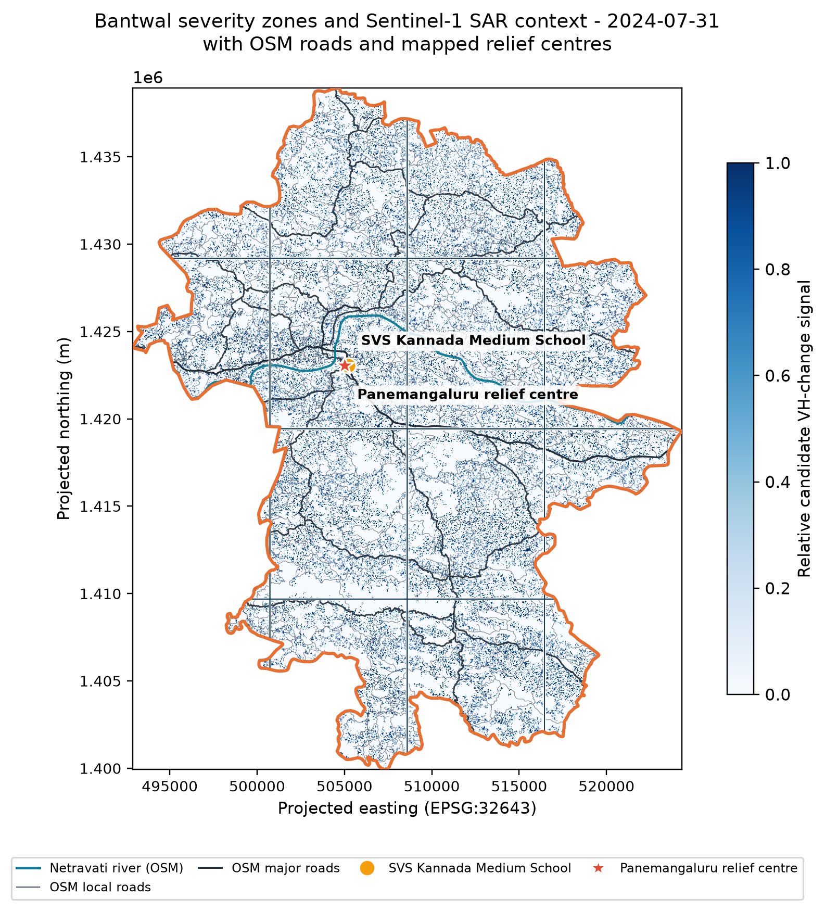
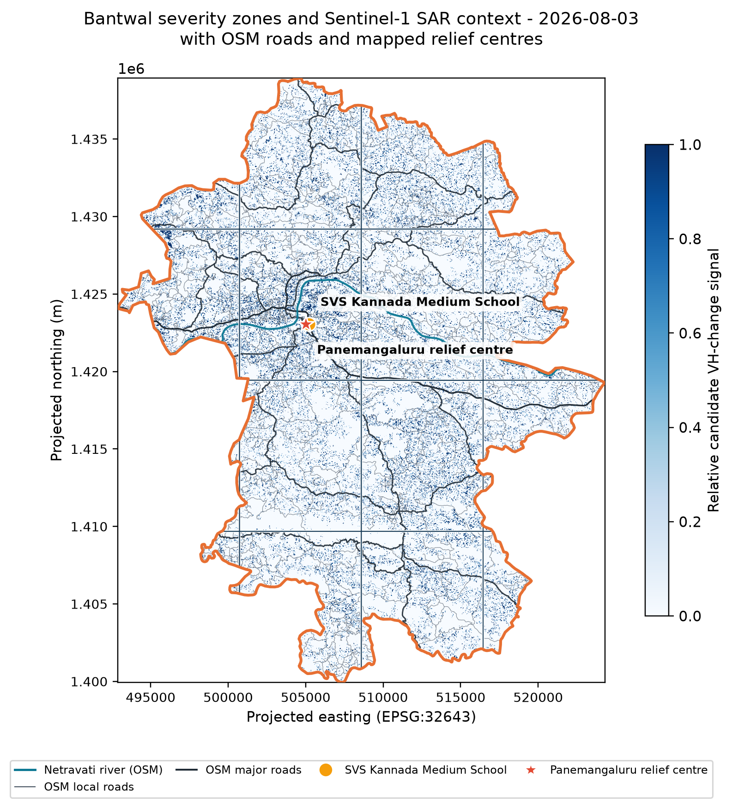
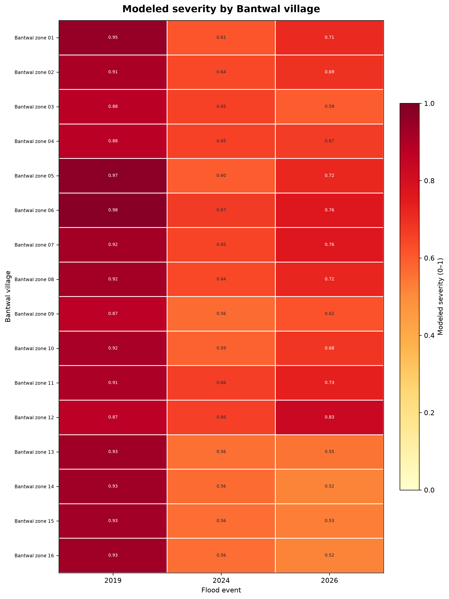
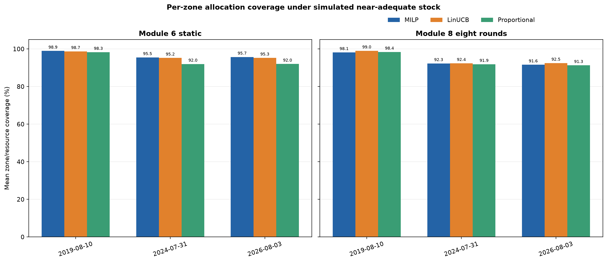

# ResQ: Bantwal relief allocation prototype

ResQ combines Sentinel-1 SAR change context, rainfall, terrain, and population estimates to score response severity and compare simulated relief allocations. The project focuses only on **Bantwal taluk**, split into exactly **16 analytical grid zones**. Every cell is clipped to the Bantwal boundary and checked for valid SAR pixels for all three event dates.

The cells are a regular 4×4 analysis grid, not official village boundaries. Population is apportioned by each clipped cell's area because sub-taluk population counts are unavailable.

## Six map figures

The first map for each event shows the SAR candidate signal, all 16 zones, and the Netravati river without roads. The companion map adds cached OpenStreetMap roads and mapped relief-centre locations.

### SAR context, zones, and river







### Roads and mapped relief centres







Only mapped points inside Bantwal appear. The markers show reported locations, not current facility status, capacity, or inventory.

## Severity and allocation





With configured prototype stock, unmet demand is **49.05%, 40.61%, and 42.85%** for the Module 6 static benchmark and **54.00%, 44.49%, and 47.47%** after eight Module 8 rounds, for 2019, 2024, and 2026. Engines share stock caps, so aggregate unmet demand can match while zone-level allocation differs.

A separate synthetic-supply scenario yields about **1.50%, 8.01%, and 8.01%** unmet demand after eight rounds. Those figures depend on assumed pooled stock and a 55% minimum service floor; they are not measured inventory or operational outcomes.

See the [zone severity table](demo/zone_severity_scores.csv), [SAR coverage table](demo/sar_zone_coverage.csv), [simulated supply results](demo/adequate_supply_summary.csv), [results](RESULTS.md), [limitations](LIMITATIONS.md), and [demo notes](demo/DEMO_NOTES.md).

## Run the project

Use Python 3.11 or later in PowerShell. Install dependencies, then generate the base Bantwal boundary and population, run Phase II, and build the demo outputs:

```powershell
python -m pip install -r requirements.txt
python -m pip install -e .
python -m resq.zones
python -m resq.population
python -m resq.roads
python -m resq.phase2
python -m resq.module8
python scripts/run_supply_target_scenario.py
python demo/build_assets.py
python validation/validate_modules0_9.py
python validation/validate_module11.py
```

The grid builder fails if any of its 16 cells has no valid SAR pixels in one of the event rasters. Phase II may download Sentinel-1 and CHIRPS inputs when they are not cached. Shelter stock and resource demand are modeled; the project has no live shelter inventory or dispatch service. The future interface could let authorized shelter officials enter actual stock for allocation.
