# ResQ: Bantwal relief allocation prototype

ResQ combines Sentinel-1 SAR change context, rainfall, terrain, and population estimates to score response severity and compare simulated relief allocations. The project focuses only on **Bantwal taluk**, split into exactly **16 analytical grid zones**. Every cell is clipped to the Bantwal boundary and checked for valid SAR pixels for all three event dates.

The cells are a regular 4×4 analysis grid, not official village boundaries. Population is a modeled estimate computed by summing WorldPop 2025 constrained 1 km raster pixels inside each cell. The 2011 Census total is kept as a comparison reference only; it does not scale the raster values.

## Six map figures

Each map numbers the 16 grid zones and uses kilometre axes with a 10 km scale bar. Relief-centre names are kept in the legend to avoid covering cell numbers.

The first map for each event shows the SAR candidate signal, all 16 zones, and the Netravati river without roads. The companion map adds cached OpenStreetMap roads and mapped relief-centre locations.

### SAR context, zones, and river


### Roads and mapped relief centres


Only mapped points inside Bantwal appear. The markers show reported locations, not current facility status, capacity, or inventory.

## Severity and allocation


With configured prototype stock, unmet demand is **49.23%, 40.84%, and 42.93%** for the Module 6 static benchmark and **55.49%, 44.69%, and 47.99%** after eight Module 8 rounds, for 2019, 2024, and 2026. These totals are driven by shared inventory caps; the engines can still distribute allocations differently across zones.

A separate simulated-supply scenario yields **1.51%, 7.99%, and 8.01%** unmet demand after eight rounds (and **2.01%, 8.69%, and 8.65%** in its static sensitivity run). These results depend on assumed pooled stock and a 55% minimum service floor; they are not measured inventory or operational outcomes.

See the [zone severity table](demo/zone_severity_scores.csv), [SAR coverage table](demo/sar_zone_coverage.csv), [simulated supply results](demo/adequate_supply_summary.csv), [results](RESULTS.md), [limitations](LIMITATIONS.md), and [demo notes](demo/DEMO_NOTES.md).

## Run the project

Use Python 3.11 or later in PowerShell. Install dependencies, download the official WorldPop raster, then generate the Bantwal boundary and population, run Phase II, and build the demo outputs:

```powershell
python -m pip install -r requirements.txt
python -m pip install -e .
python -m resq.zones
python scripts/download_worldpop_raster.py
python -m resq.population
python -m resq.roads
python -m resq.phase2
python -m resq.routing --event-date 2019-08-10
python -m resq.routing --event-date 2024-07-31
python -m resq.routing --event-date 2026-08-03
python -m resq.module8
python scripts/run_supply_target_scenario.py
python demo/build_assets.py
python validation/validate_modules0_9.py
python validation/validate_module11.py
```

The configured raster is WorldPop Global2 R2025A v1 for India, 2025, constrained, 1 km (`1km_ua`). Population pixels are summed by cell without census normalization. The Bantwal polygon sum is 677,985.36 over 674.38 km² (1,005.35 people/km²), or 1.715× the Census 2011 reference of 395,380. This comparison is reported as-is; the result is a modeled estimate, not an updated census count. See [`RESULTS.md`](RESULTS.md) and [`LIMITATIONS.md`](LIMITATIONS.md).

The grid builder fails if any of its 16 cells has no valid SAR pixels in one of the event rasters. Phase II may download Sentinel-1 and CHIRPS inputs when they are not cached. The project has no live shelter telemetry or dispatch service. Operators can import a field-log CSV; those manual, unverified quantities form a separate pooled inventory for the next allocation.

## Run the API

The FastAPI prototype wraps the existing allocator, Module 7 routing, and Module 8/9 closure benchmark. Its routes cover events, zones, simulation, verified closures, allocations, routes, and escalations. It serves the 16 Bantwal grid zones and three documented event replays. `/events` works without the spatial cache; zones, allocation, and closure operations need generated artifacts from the pipeline commands above. Most `data/processed` files are intentionally git-ignored. The frontend provides demo-level role controls and facility stock entry, but this remains a research prototype without live dispatch integration or multi-worker job isolation.

```powershell
python -m pip install -e ".[phase2,geo]"
uvicorn resq.api:app --host 127.0.0.1 --port 8000
```

Open `http://127.0.0.1:8000/docs` for the interactive API schema. Example requests:

```powershell
Invoke-RestMethod http://127.0.0.1:8000/events
Invoke-RestMethod "http://127.0.0.1:8000/zones?event=2019-08-10"
Invoke-RestMethod -Method Post http://127.0.0.1:8000/simulate `
  -ContentType "application/json" `
  -Body '{"event":"2019-08-10","engine":"MILP","stock_mode":"configured"}'
```

Use `stock_mode: "simulated"` only to run the separately labeled pooled-stock assumption. All stock modes are assumed inventory, never live facility stock. `/closures` accepts a verified closure ID from that event's closure GeoJSON, runs Module 8 and reroutes all 16 zones with Module 7. Module 8 and Module 7 consume all verified closures in that event file. Run, selected-engine allocations/escalations, and per-zone route outputs are persisted in `data/processed/resq_service.sqlite3`; fetch the routes with `GET /routes/{run_id}`.

Docker Compose builds the backend API (port 8000) and static frontend (port 3000). The API image installs its Python dependencies; it does not include the ignored spatial cache. Generate the road graph, analysis zones, event features, and closure files first; Compose mounts `data/processed` from the host. The browser calls the API at `http://127.0.0.1:8000` and the API allows the local 3000/5173 origins, so this setup is intended for a browser on the same machine as Docker. It is not configured for remote-host deployment or TLS. The frontend image includes checked-in snapshots for read-only replay.

```powershell
docker compose up --build -d
docker compose ps
docker compose logs -f api
```

Check `docker compose ps` and `docker compose logs -f api`; the API health check only confirms `/events` responds. Verify `http://localhost:3000` and `http://localhost:8000/health` in a browser. The API can serve live allocations and road reroutes only when the generated artifacts are present in the mounted `data/processed` directory. Stop the services with `docker compose down`.

## Run the Frontend

Module 10 is an interactive command console built with React, TypeScript, Vite, MapLibre GL, and locally implemented React Bits components (Aurora, GradientText, SpotlightCard, and StarBorder).

The console map shows the 16 Bantwal grid zones, cached Bantwal roads, the Netravati river, and mapped facility points. The Scenario Deck has five mapped trunk or primary road blockage scenarios inside the Bantwal analysis boundary: three single-road cases, one two-road case, and one three-road case. Every failed road is drawn in red, with a closure marker, and the API recalculates routes for all 16 zones on the cached OSM graph. Scenarios that close the Netravati Bridge also include and display the Mini Town Hall in Mangaluru as a routing origin. These fast route-only actions do not run the allocation replay. Select a zone to inspect its route; a disconnected zone is labeled unavailable rather than shown with a false road route. Routing does not query live OSM services.

```powershell
cd frontend
npm ci
npm run build    # Produces frontend/dist, including public offline snapshots
npm run preview  # Previews the static build at http://localhost:4173
```

The static build includes local Bantwal map layers, gauge readings, event replays, allocation snapshots, and stock-sweep curves. Without the API, these are read-only; allocation edits/reruns, stock updates, overrides, and live road-blockage rerouting require the backend. Offline mode means no API connection, not an installable or fully self-contained offline web app: serve the static build locally, and expect remote Google Fonts to use fallback fonts when internet access is unavailable. To refresh snapshots after regenerating processed results, run `python scripts/export_frontend_data.py` from the repository root before building.

Demo login presets:
- **Viewer** (`viewer` / `viewer2026`): Inspects replays, routes, scarcity curves, and shortage escalations.
- **Operator** (`operator` / `operator2026`): Authorized for road closures, facility stock updates, and admin overrides.

### Import Field Logs

1. Sign in as the Operator and click **Entered · Field logs** in the stock selector. The Field Logs panel opens only from that control.
2. Download [the sample field-log CSV](frontend/public/data/sample_field_logs.csv) or prepare a CSV with `facility_id,resource,quantity,unit,note` columns. Resource values are `food_rations`, `water_liters`, and `medical_kits`; facility IDs must already exist in the inventory.
3. Choose the CSV. The import validates the whole file before saving it as one snapshot. Rows in the CSV become operator-entered stock; omitted facilities/resources return to baseline assumed stock and do not count toward entered-stock allocations.
4. Click **Run allocation with field logs** (or close the panel and use **Run Allocation Replay**) to allocate from the imported pool. The sample totals are illustrative only (50,000 food rations, 250,000 liters of water, and 660 medical kits). For the 2024 MILP demo they produce a mix of full zone coverage and a partial zone in the 60–90% range. These are not observed stock reports.

### Phase III Interactive Dashboard Screenshots

| Feature | Screenshot | Description |
|---|---|---|
| **Bantwal Console** | 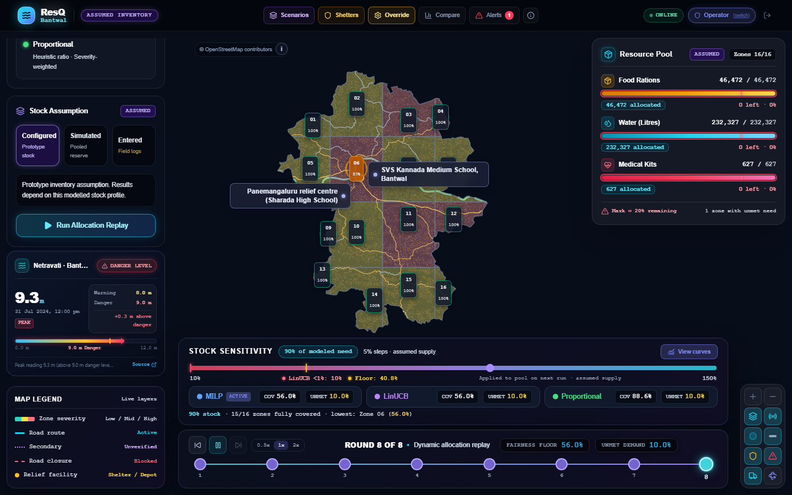 | Shows all 16 zone coverage labels, event gauge, resource status, stock sensitivity, and the eight-round timeline. |
| **Scarcity Curves** | 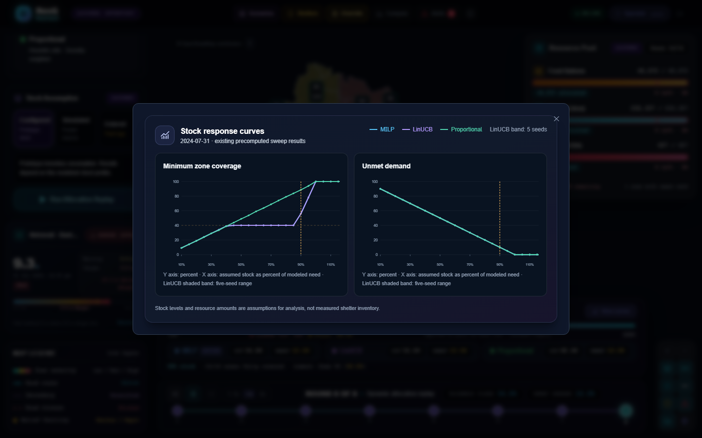 | SVG curves of minimum zone coverage and unmet demand across stock levels (10% to 150%) for MILP, LinUCB (five-seed envelope), and Proportional. |
| **Scenario Deck** | 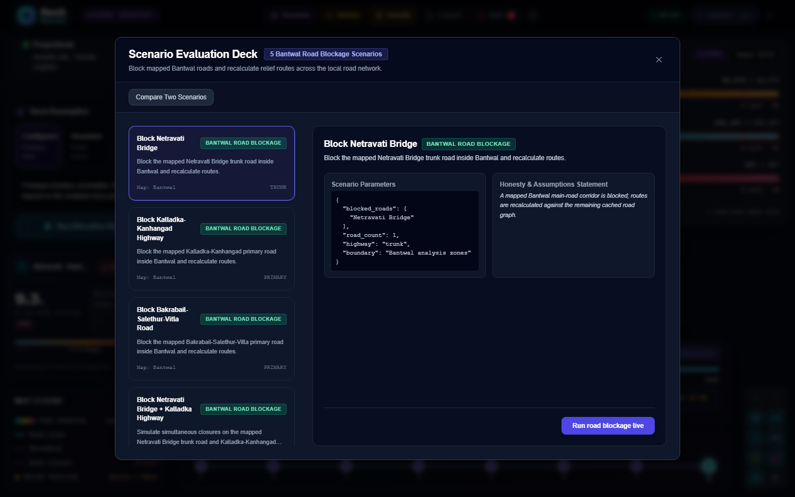 | Five Bantwal main-road blockage scenarios, including simultaneous two-road and three-road failures; each recalculates routes on the cached graph. |
| **Shelter Inventory** | 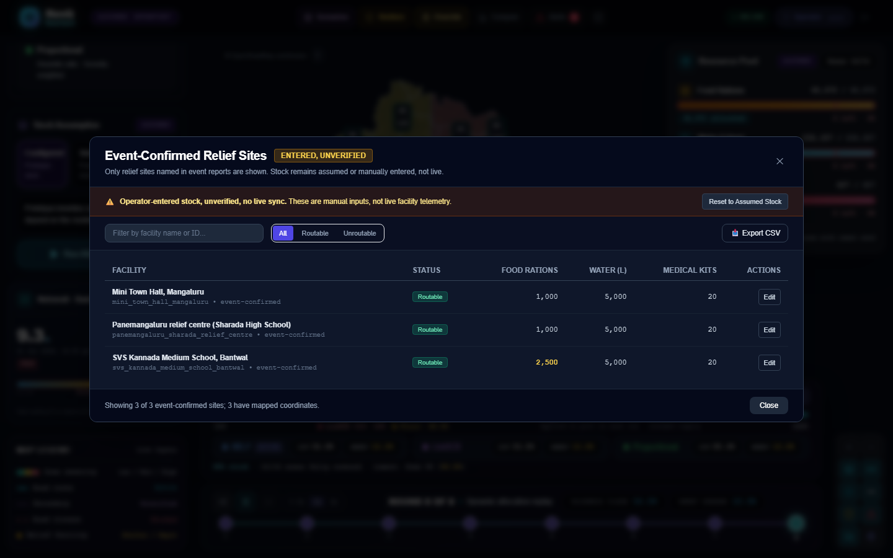 | Lists three event-confirmed sites; their stock is assumed or manually entered and is not live inventory. |
| **Shortage Escalations** | 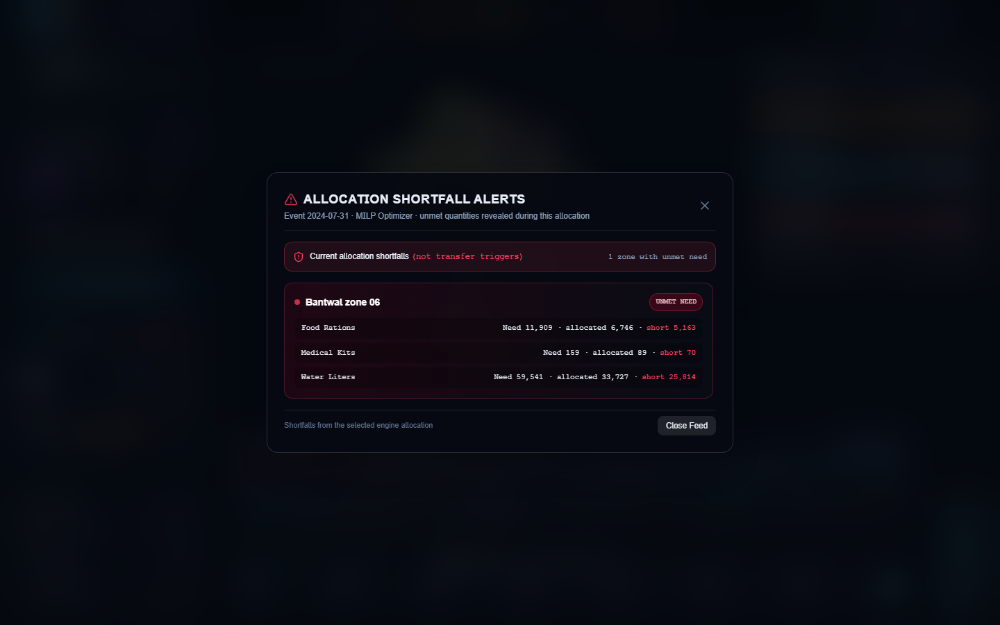 | Shows the recorded shortage alerts and resource reallocation triggers for the selected replay. |
| **Admin Override** | 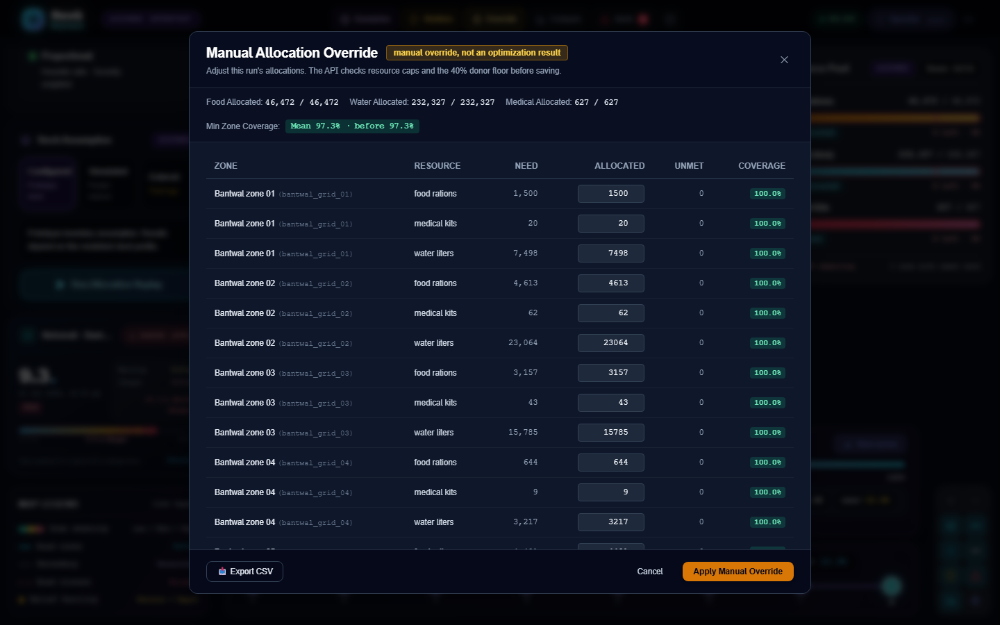 | Editable allocation table blocks edits exceeding inventory or dropping below the donor floor, labeled "manual override, not an optimization result". |
| **Road Blockage & Rerouting** | 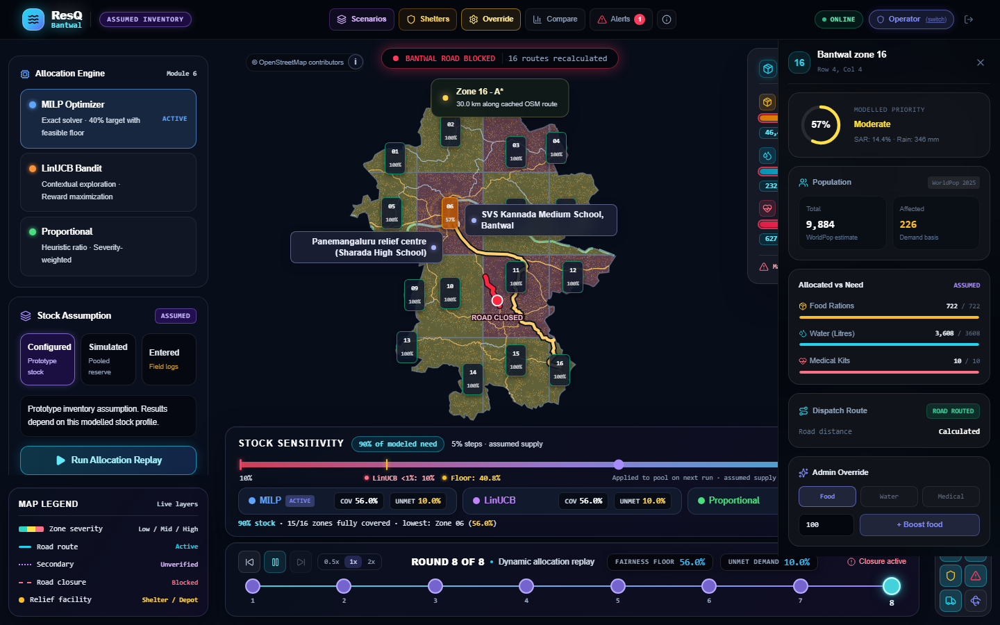 | Configured-stock MILP allocations are shown first, followed by the Kalladka-Kanhangad Highway closure in red and 16 routes recalculated. |
| **Zone Details** | 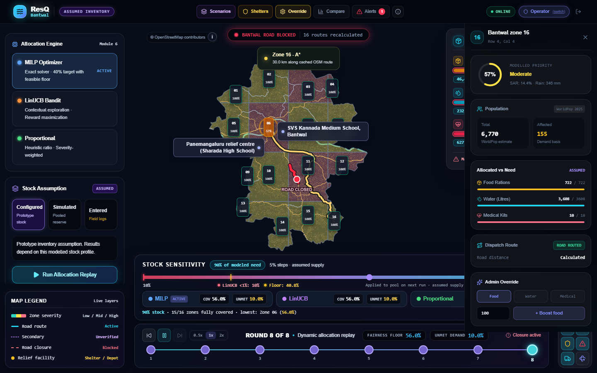 | Zone 16 allocation details and rerouted path for the same Kalladka-Kanhangad Highway closure, with MILP and configured prototype stock. |
| **Data Sources & Limits** | 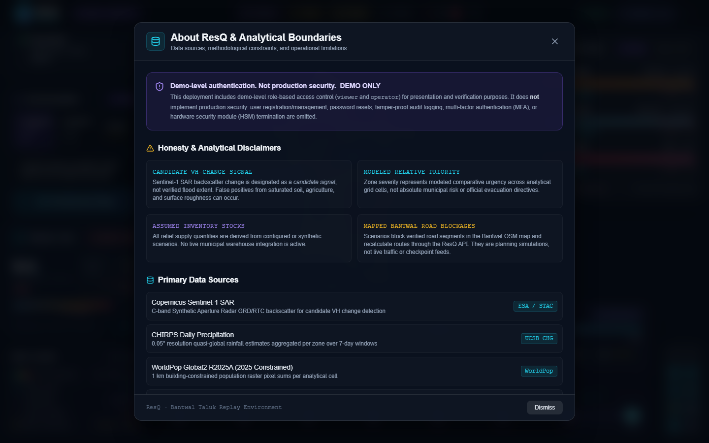 | Summarizes analytical boundaries, data sources, and limitations. |

### System design diagrams

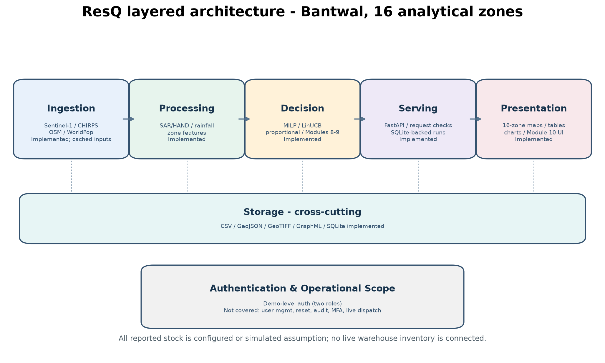

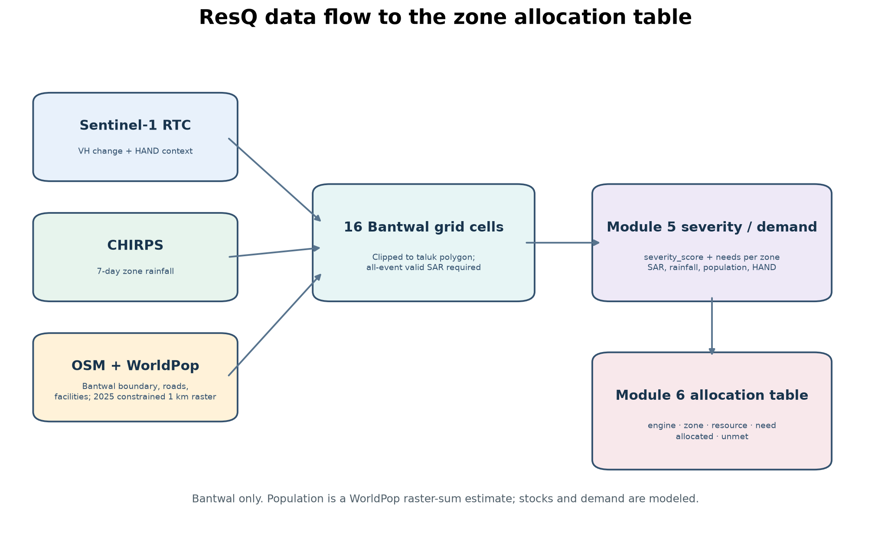

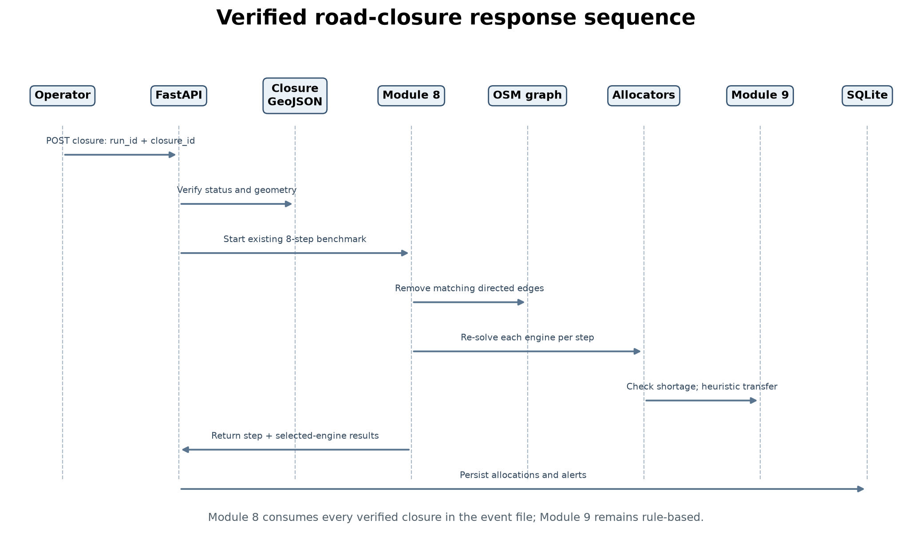

## Testing and Validation

Install dependencies and run test and validation suites:

```powershell
# Python API and module test suites
python -m pytest --basetemp=.pytest-tmp tests

# Modules 0-9 core validator matrix
python validation/validate_modules0_9.py

# Module 11 report compiler & dynamic benchmark
python validation/validate_module11.py

# Stock sweep generator & bisection search
python validation/stock_sweep.py

# Playwright E2E browser test suite
cd frontend
npx playwright test
```

The pytest and Playwright commands above cover the API and browser interface. The Modules 0-9 and Module 11 validators check the analytical pipeline for all three event dates. Module 7 computes a road route or secondary-distance candidate for all 16 zones in each event; its event-data status remains partial because some reported closure labels are unresolved.

The scaling benchmark uses generated workload rows and is not a disaster outcome:

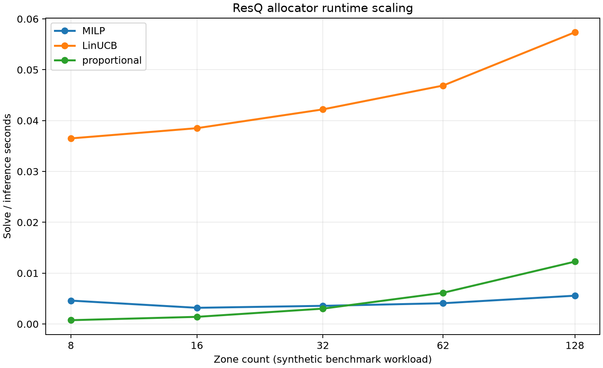

```powershell
python validation/scaling_benchmark.py
```
