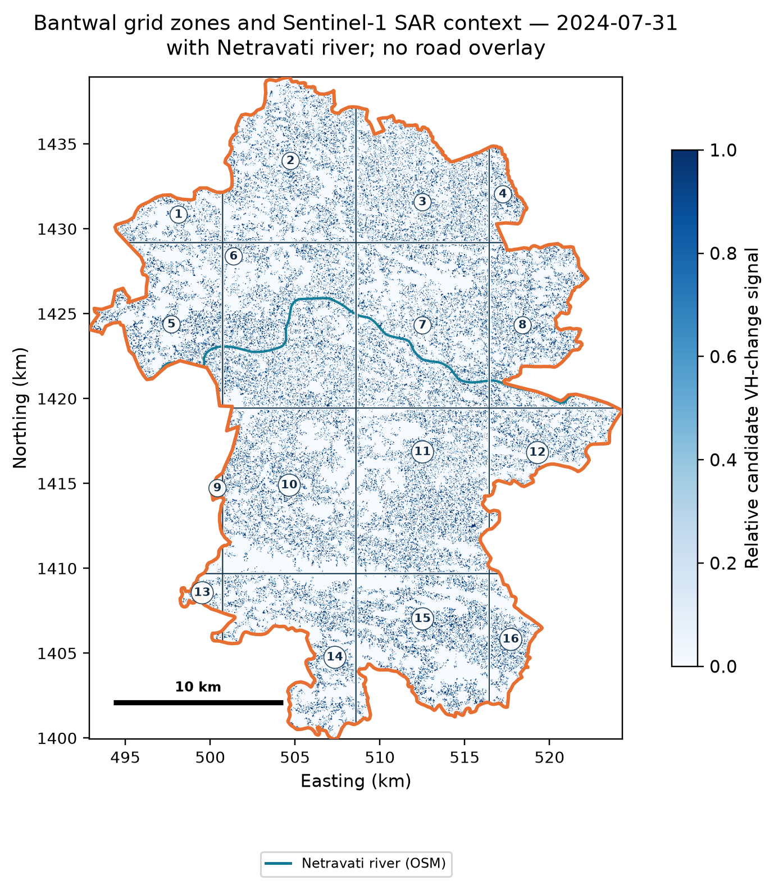
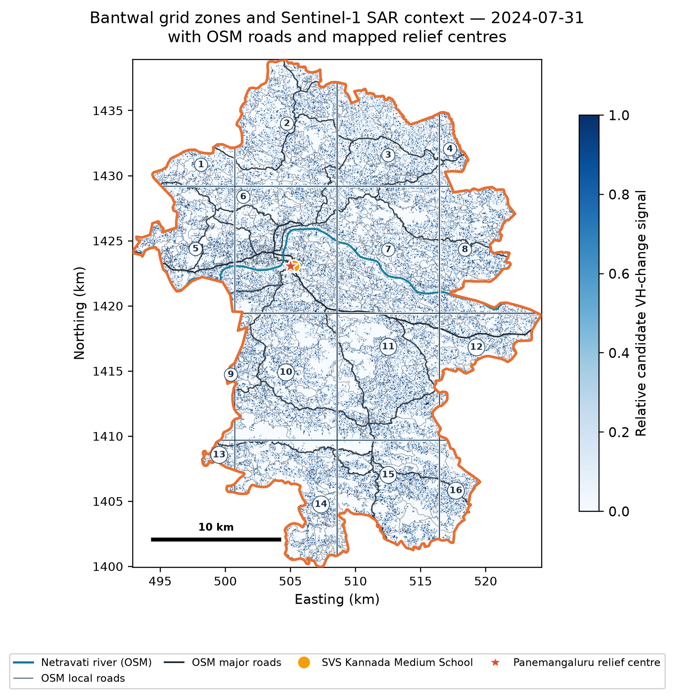
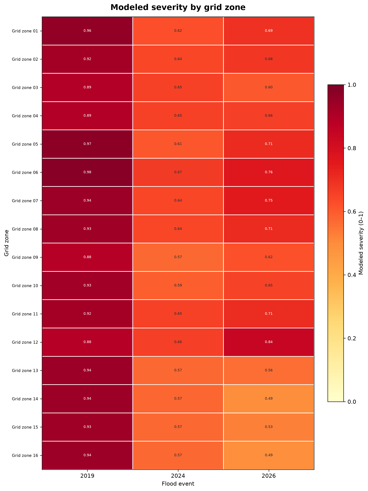
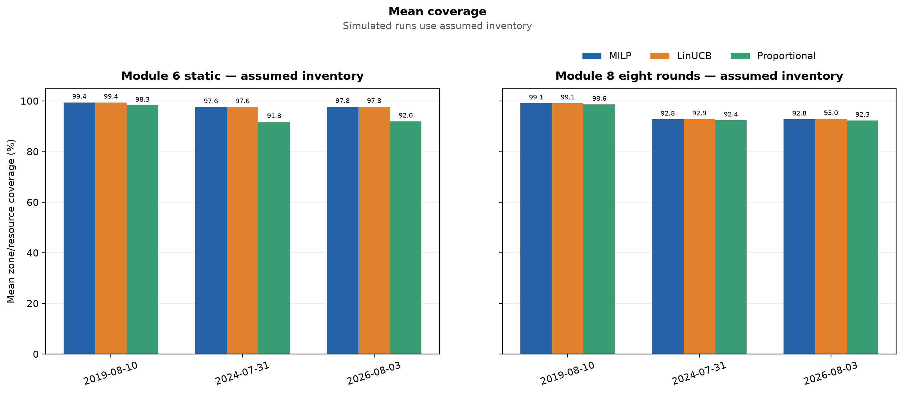

# ResQ at a glance

ResQ models severity and relief allocation for three Netravati flood events. The analysis is restricted to Bantwal taluk, split into 16 regular grid zones clipped within the taluk boundary.

## Configured-stock benchmark

| Event | Module 6 unmet demand | Module 8 unmet demand after 8 steps |
|---|---:|---:|
| 2019-08-10 | 49.23% | 55.49% |
| 2024-07-31 | 40.84% | 44.69% |
| 2026-08-03 | 42.93% | 47.99% |

All engines share the same aggregate inventory caps, so aggregate unmet demand can match. Their allocation patterns and minimum zone coverage differ; the zone charts show those differences.

## Simulated near-adequate supply sensitivity

This separate scenario assumes larger pooled stock and a 55% minimum service floor. After eight rounds, it results in 1.51%, 7.99%, and 8.01% unmet demand for 2019, 2024, and 2026; its static sensitivity results are 2.01%, 8.69%, and 8.65%. These are scenario outputs, not actual inventory or real-world results.

For complete numbers, see [results](../RESULTS.md) and [limitations](../LIMITATIONS.md).
