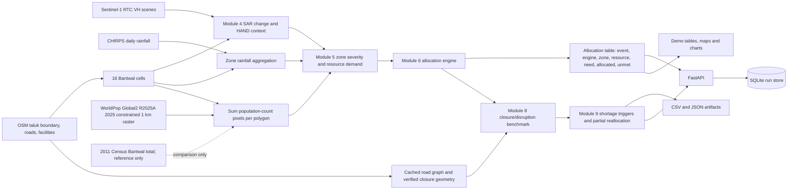
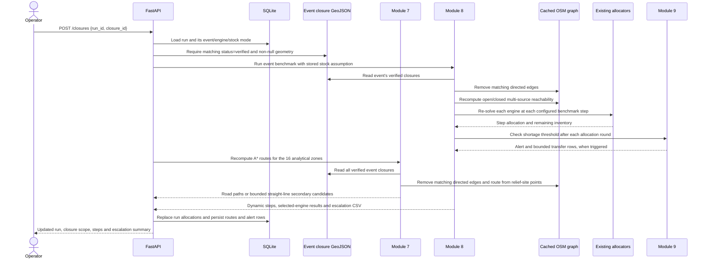

# ResQ system architecture

This document describes the checked-in implementation and cached artifacts, not the earlier three-taluk design. The current analytical scope is **Bantwal taluk with exactly 16 regular clipped grid cells**. They are analytical cells, not official administrative boundaries.

## Layered architecture

| Layer | Current components | Status | Notes |
|---|---|---|---|
| Ingestion | Sentinel-1 RTC STAC search/crop in `resq.severity.sar`; CHIRPS daily raster fetch in `resq.rainfall`; OSM boundary/roads/facilities helpers in `resq.osm`, `resq.zones`, `resq.roads`; official WorldPop GeoTIFF bootstrap in `scripts/download_worldpop_raster.py`; event CSV reader in `resq.events` | Implemented, with cached-input dependency | WorldPop raster is downloaded once to ignored `data/raw`; all population summaries are then local raster pixel sums. Most generated inputs are not committed. |
| Processing | 16-cell grid in `resq.subzones`; SAR/HAND features; rainfall aggregation; Module 5 severity/demand; road graph and closure matching | Implemented | The grid builder fails if an event SAR raster has no valid pixels in any cell. CHIRPS edge-cell point sampling is an implemented fallback. |
| Decision | Module 6 OR-Tools MILP, LinUCB and proportional comparator; Module 8 repeated closure/stress allocation; Module 9 shortage alerts and partial transfers | Implemented | Stock/demand are assumptions. Module 8 also includes synthetic demand/hazard evolution. |
| Serving | FastAPI routes and SQLite run/allocation/route/escalation persistence in `resq.api` | Implemented | Verified closure requests run Module 8/9 and Module 7 rerouting for all 16 cells. Single-process locking protects legacy fixed-file writers; this is not a multi-worker job queue. |
| Presentation | `demo/build_assets.py`, maps, charts, README, and Module 10 interactive console in `/frontend` | Implemented | Interactive web console and static artifacts. Maps present SAR as a candidate VH-change signal, not verified flood extent. |
| Storage (cross-cutting) | CSV, GeoJSON, GeoTIFF, GraphML, JSON plus SQLite service database | Implemented | Storage is shared by ingestion through presentation. SQLite provides local prototype persistence. Most `data/raw` and `data/processed` artifacts are git-ignored. |
| Container deployment | `Dockerfile`, `docker-compose.yml`, `.dockerignore` | Locally build and smoke-tested | Compose builds API and frontend images. The API mounts generated `data/processed`; `/events` health does not validate the spatial cache or live routing. Intended for same-host browser access, without TLS or remote-host configuration. |
| Web UI & Authentication | `/frontend` dashboard, FastAPI JWT & bcrypt RBAC (`viewer`, `operator`) | Demo-level (two roles) | Implemented interactive Module 10 frontend with React, MapLibre GL, and offline fallback. Demo authentication supports `viewer` (replay access) and `operator` (closure and override actions). Still not covered: user management/registration, password reset, audit logging, multi-factor authentication (MFA), and HTTPS termination. Live municipal fleet dispatch remains planned. |

## Data flow



The current pipeline outputs `severity_demand_{event_date}.csv` and Module 6's `allocation_matrix_{event_date}.csv`. The API persists the selected engine's allocation rows in SQLite. Module 8 consumes the verified event closure GeoJSON and cached road graph; it does not take arbitrary client coordinates.

## Road-closure sequence



Module 8 currently consumes **all verified closures in the event file** and runs all three engines. `closure_id` validates the caller's requested closure; it is not a selector passed into Module 8. This follows the current function interface and is surfaced in the response/documentation.

## Data model based on current artifacts

| Entity | Current source / fields | API or SQLite representation |
|---|---|---|
| Event | `data/processed/events.csv`: `event_date`, `river_gauge`, `water_level_m`, `affected_localities`, `roads_blocked`, `houses_affected`, `source_url` | `GET /events`; event date is the stable key. |
| Zone | `analysis_zones.geojson` geometry and properties: `zone_id`, `name`, `zone_type`, `parent_zone_id`, `parent_name`, `grid_row`, `grid_column`, `centroid_lat`, `centroid_lon`, `population_area_km2`, `population_year`, `population_model`, `population_resolution`, `population_constrained`, `population_source`, `population_basis`, `population_valid_pixel_count`, `population_worldpop_raw_estimate`, `boundary_source`, `population_estimate`, `population_density_per_km2` | `GET /zones?event=...` joins geometry with event demand features. Exactly 16 expected. Population values are modeled estimates from native pixel sums; the Census comparison is configuration/reference text only and is not stored with zone outputs. |
| Zone event features / need | `severity_demand_{date}.csv`: `event_date`, `zone_id`, `zone_name`, `severity_score`, `severity_model`, `training_basis`, `sar_likelihood`, `gauge_hand_inundated_fraction`, `antecedent_7day_rainfall_mm`, `population_estimate`, `estimated_affected_people`, `estimated_food_rations`, `estimated_water_liters`, `estimated_medical_kits`, `estimate_status` | Returned with zones; values remain modelled estimates. |
| Closure | `closures_{date}.geojson`: geometry plus `closure_id`, `name`, `status`, `source`, `reason`; verified ways may also have `osm_ref`, `osm_way_ids`, `matching_method`, `verification_scope`, `closure_note` | `/closures` accepts a `closure_id`; only `status=verified` with geometry is accepted. |
| Facility | `warehouses.geojson`: Point features may have `name`, `warehouse_id`, `confidence`, `source`, `event_source`, `osm_feature`, `route_origin`, `confidence_note`; some features have null geometry | Used by routing and Module 8 as mapped origin candidates. No stock/capacity is sourced. No facility CRUD endpoint exists. |
| Run | New SQLite `runs`: `run_id`, `event_date`, `engine`, `stock_mode`, `inventory_basis`, `status`, `created_at`, `closure_ids_json`, `summary_json` | Created by `POST /simulate`; closure processing updates it. |
| Allocation | Existing CSV fields: `event_date`, `engine`, `zone_id`, `zone_name`, `resource`, `estimated_need`, `allocated`, `unmet`, `unmet_pct`, `inventory_source` | SQLite `allocations`: `run_id`, `zone_id`, `zone_name`, `resource`, `estimated_need`, `allocated`, `unmet`, `unmet_pct`. |
| Escalation | `escalation_log_{date}.csv`: `trigger_id`, `event_date`, `step`, `engine`, `threshold`, `resource_types_short`, `shortfall_by_resource`, `remaining_inventory`, `remaining_unmet_demand`, `inventory_to_unmet_ratio`, `affected_zone_ids`, `transfer_count`, `min_zone_coverage_before_pct`, `min_zone_coverage_after_pct` | SQLite `escalations`, JSON-encoding the three resource maps. |
| Route | `routes_analysis_{date}.csv`: `zone_id`, `zone_name`, `status`, `road_status`, `secondary_status`, `delivery_mode`, `origin_id`, `road_distance_m`, `secondary_distance_km`, `secondary_payload_capacity_kg`, `secondary_trip_count`, `path_node_ids` | SQLite `routes`: `run_id`, `zone_id`, `delivery_mode`, `road_status`, `secondary_status`, `details_json`; returned by `GET /routes/{run_id}` after closure processing. |

## API contract

Base URL for local use: `http://127.0.0.1:8000`. JSON errors have a `detail` object with a stable `code` and readable `message`.

### `GET /events`

Returns the configured historical event records and the fixed study scope.

```json
{"scope":"Bantwal taluk; 16 analytical grid zones","events":[{"event_date":"2019-08-10","river_gauge":"Bantwal","water_level_m":11.6,"affected_localities":["Bantwal Kelagina Pete","Panemangaluru"],"roads_blocked":["Talapady service road"],"houses_affected":"58 houses inundated; ...","source_urls":["https://..."]}]}
```

### `GET /zones?event=2019-08-10`

Returns 16 Bantwal geometries and matching event features/demand. Unknown dates return `404 unknown_event`; missing generated inputs return `503` with `zones_unavailable` or `event_features_unavailable`.

```json
{"event":"2019-08-10","scope":"Bantwal","zones":[{"zone_id":"bantwal_grid_01","population_estimate":12345.67,"population_status":"modeled_estimate","population_year":2025,"population_resolution":"1km","population_density_per_km2":456.7,"severity_score":0.61}]}
```

### `POST /simulate`

Runs the existing static Module 6 comparison and persists only the requested engine's output. `stock_mode` is `configured` or `simulated`; both are assumptions, never live stock. In `simulated` mode the pooled stock for the event from `demo/adequate_supply_summary.csv` is used.

Request:

```json
{"event":"2019-08-10","engine":"MILP","stock_mode":"configured"}
```

Response (`201`; abbreviated):

```json
{"run_id":"<uuid>","event":"2019-08-10","engine":"MILP","stock_mode":"configured","inventory_basis":"assumed_inventory: config/region.yaml prototype_inventory","hard_fairness_target_status":"INFEASIBLE","summary":{"engine":"MILP","aggregate_unmet_demand_pct":"..."}}
```

An infeasible hard-target solve is recorded as `INFEASIBLE`; the existing Module 6 function may then return its separately feasible shortage fallback and records the effective floor. An unhandled infeasible solve returns `409 infeasible_run`. Unknown event returns `404`; invalid engine/mode returns `422`.

### `POST /closures`

Applies a verified event closure through Module 8 to a previously persisted run. Module 8 runs the full 8-step comparison for all three engines, then the API selects the run's engine for persistence. All event closures marked verified are consumed by the current Module 8 function.

```json
{"run_id":"<uuid>","closure_id":"2024-07-31_1"}
```

Response (`200`; abbreviated):

```json
{"run_id":"<uuid>","event":"2024-07-31","engine":"MILP","applied_closure_id":"2024-07-31_1","closure_geometry":"MultiLineString","closure_scope":"...corridor-level...","stock_mode":"configured","inventory_basis":"assumed_inventory: ...","steps":[{"step":"1","closure_active":"False"}],"module9":{"trigger_count":8,"transfer_count":0}}
```

Returns `404` for an unknown run/closure, `422 closure_not_verified`, `409 closure_already_applied` or `409 infeasible_run`; missing artifacts/runtime errors return `503 closure_run_failed`.

Applying a verified closure also runs Module 7 on the event's verified closure set and persists route results for all 16 analytical cells.

### `GET /allocation/{run_id}`

Returns persisted run metadata and zone/resource rows. Unknown run returns `404 unknown_run`. The response always carries `inventory_basis`; simulated inventory is explicitly `assumed_inventory`.

### `GET /routes/{run_id}`

Returns the 16 persisted Module 7 route rows after closure processing, including road status, delivery mode, route distances, path nodes, and candidate secondary geometry where applicable. A secondary geometry is straight-line distance context only; payload and water/air navigation feasibility are not inferred. Unknown run returns `404 unknown_run`.

### `GET /escalations/{run_id}`

Returns persisted Module 9 trigger rows for the selected engine. Before a closure benchmark, this is an empty list. Unknown run returns `404 unknown_run`.

## Design decisions

| Decision | Chosen option | Alternative | Reason | Cost |
|---|---|---|---|---|
| Allocation engines | Existing OR-Tools MILP, LinUCB, proportional baseline | Replace or consolidate policies | Preserve the implemented comparison and its output schema | Three algorithms and result formats must be maintained. |
| SAR processing | Offline/event batch processing from Sentinel-1 RTC cache or public STAC | Request SAR inside each API call | Expensive/rate-limited raster work is separated from interactive requests | API requires prebuilt event rasters and severity/demand CSVs. |
| Routing | A* over cached OSM graph; Module 8 uses graph reachability after edge removal | Live routing service or download graph on demand | Reuses cached road data and current routing utility | Graph freshness and graph coverage depend on cache; reachability is not live traffic. |
| Escalation | Existing rule-based shortage threshold and bounded partial reallocation | New optimizer or policy layer | Keep Module 9 behavior unchanged and auditable | It is a heuristic, not an optimal reallocation guarantee. |
| Persistence | SQLite file database | Shared database service | Low-setup persistence for the local prototype | Single-node database and filesystem artifacts limit concurrency/scale. |

## Failure modes and actual behavior

| Failure | Current behavior |
|---|---|
| Missing SAR raster / no valid SAR in one grid cell | `resq.subzones.build_grid` raises with missing path or zone coverage counts; it does not silently drop a cell. API returns `503` when the required generated zone/demand inputs are missing. |
| Missing WorldPop raster | `resq.population` raises `FileNotFoundError` naming the configured GeoTIFF and instructing the user to download it. There is no census or area-weight fallback. |
| SAR scene lookup/crop failure | Module 4 raises when no acquisition is found; per-zone failures are recorded in the zone CSV, but no event raster is written unless a matched locality zone was processed. No live API SAR retry is implemented. |
| Missing rainfall source/cache | CHIRPS downloader fetches a missing daily raster. A zone with no pixels samples its representative point. If the source/network still fails, generation raises; the allocator does not impute rainfall. |
| No rainfall value for a cell | The CSV can contain NaN if all daily pixels and point samples fail. API conversion then fails; no API-level imputation is implemented. |
| Missing/corrupt cached road graph | The FastAPI service starts without the graph so non-routing endpoints remain available. A closure/routing operation returns `503 road_graph_unavailable` with the graph-load error; generate or repair the cache and restart the service. |
| Disconnected zone after road closure | `compute_routes` labels a route unavailable or secondary where eligible. Module 8 computes open/closed reachability and detours; unreachable zones are marked as impacted. A global cross-engine infeasibility policy is not added. |
| Infeasible allocation | Module 6 first tests the hard fairness target. On its known infeasible path, it records that status and solves again at the maximum feasible common floor. The API returns that result with the status. If no fallback result is produced, API maps the error to `409`. |
| Missing facility coordinates | Routing cannot use null-geometry features; if no usable origin remains, existing routing raises. API closure processing returns `503` if Module 8 cannot find an origin that snaps to the graph. No coordinate is invented. |
| Missing/unverified closure | API rejects unresolved/missing geometry (`422`) or unknown closure (`404`). |
| Legacy file-output collision | API serializes allocator/Module 8 calls with a process-local lock. Multiple server workers/replicas are not protected; use one worker until jobs/artifact paths are made run-specific. |

## Scalability

The geographic region and grid rows/columns are config values, but the active builder and validators intentionally require **exactly 16 cells**; changing counts requires code/validator changes. Resource types, inventory, fairness target, shortage threshold, redirect fraction, and closure activation step are configured. Module 8 accepts 5–10 steps; default benchmark is 8. Its event list and closure geometry are data-driven. The API is local/single-process today.

`validation/scaling_benchmark.py` measures the existing allocator kernels on generated synthetic workload sizes 8, 16, 32, 62, and 128, plus cached graph load time. These are computational stress tests, not event outcomes. `peak_python_heap_mb` uses `tracemalloc` and may omit native-library memory. The measured table and chart are generated under `data/processed/scaling_benchmark.csv` and `demo/scaling_benchmark.png`.

Measured on this Windows development machine on 2026-10-28; one invocation per size, so treat these as local measurements rather than portable service-level guarantees. Allocator values are seconds / peak traced Python heap MiB. LinUCB training was timed separately; its inference column excludes training. MILP time is the solver-reported solve duration. No allocator size failed or timed out.

| Zones | MILP solve s / MiB | LinUCB inference s / MiB | LinUCB training s | Proportional s / MiB |
|---:|---:|---:|---:|---:|
| 8 | 0.003871 / 0.0132 | 0.032549 / 0.0109 | 0.5812 | 0.001043 / 0.0019 |
| 16 | 0.002607 / 0.0103 | 0.031988 / 0.0168 | 0.5053 | 0.003190 / 0.0022 |
| 32 | 0.002491 / 0.0182 | 0.034280 / 0.0291 | 0.5482 | 0.012329 / 0.0029 |
| 62 | 0.004152 / 0.0328 | 0.036745 / 0.0521 | 0.7610 | 0.037509 / 0.0049 |
| 128 | 0.005760 / 0.0655 | 0.060169 / 0.1030 | 1.8027 | 0.216006 / 0.0095 |

The cached `data/processed/road_graph.graphml` took **31.592 s** to load and used **444.054 MiB peak traced Python heap**. This includes GraphML parsing into the current NetworkX representation. Benchmark inputs are generated per size with a 55% pooled-inventory ratio; they are not actual zone forecasts or resource recommendations. Chart: [`demo/scaling_benchmark.png`](../demo/scaling_benchmark.png); complete rows and status: `data/processed/scaling_benchmark.csv`.

## Current repository inputs/outputs and scope mismatch

The inspected runtime inventory is:

| Purpose | Current code | Input files / artifacts used | Main outputs |
|---|---|---|---|
| Events and boundaries | `resq.events`, `resq.zones` | `config/region.yaml`; `data/processed/events.csv`; cached `zones.geojson`; OSM caches such as `data/raw/osm_admin_boundaries_2020528.json`, place candidates and `osm_roads_2020528.json` | `zones.geojson`, `unresolved_zones.csv` |
| Population | `resq.population`, `resq.subzones`, `scripts/download_worldpop_raster.py` | `data/raw/ind_pop_2025_CN_1km_R2025A_UA_v1.tif`; Bantwal polygon in `zones.geojson`; census value in config is reference-only | Raster-summed population properties in parent and `analysis_zones.geojson`; `population_parent_summary_2025.csv`, `zone_population_2025.csv` |
| SAR and terrain context | `resq.severity.sar` | zone polygon; public Sentinel-1 RTC STAC scenes; ASF HAND COG; generated/current event rasters | `flood_likelihood_{date}.tif`, `sar_manifest_{date}.json`, `zone_severity_{date}.csv` |
| Rainfall and demand | `resq.rainfall`, `resq.ml.demand`, `resq.phase2` | CHIRPS daily rasters under `data/raw/chirps/`; `analysis_zones.geojson`; `zone_rainfall_{date}.csv`; `gauge_hand_zone_features.csv` | `zone_rainfall_{date}.csv`, `severity_demand_{date}.csv`, severity model/ablation CSV/JSON |
| Roads and closures | `resq.roads`, `resq.routing` | cached OSM road JSON; `road_graph.graphml`; `warehouses.geojson`; `closures_{date}.geojson`; `analysis_zones.geojson` | node mapping, `routes_analysis_{date}.csv/.geojson`, route metadata |
| Static allocation | `resq.optimization.allocation.run_allocators` | `severity_demand_{date}.csv`; configured prototype inventory or the demo scenario stock | `allocation_matrix_{date}.csv`, `allocation_comparison_{date}.csv`, `allocation_zone_metrics_{date}.csv`, allocation metadata |
| Dynamic allocation/escalation | `resq.module8.run_module8`, `resq.module9` | event demand, cached graph, verified event closure geometry, facility points, configured stock | `module8_dynamic_steps_{date}.csv`, `module8_dynamic_summary_{date}.json`, zone-unmet CSV, `escalation_log_{date}.csv`, transfer and redirect-trace CSVs |
| Facility & stock management | `resq.facilities` | `data/processed/facilities.json`, user CSV imports | SQLite `facilities`, `stock`, `stock_audit` tables in `resq_service.sqlite3` |
| Benchmark scenarios | `resq.scenarios` | `config/scenarios.yaml`, event data, closure GeoJSON | Analytical benchmark outputs for offline evaluation; separate from the frontend road-blockage deck |
| Stock sweep & bisection | `validation.stock_sweep` | demand features, allocators, `resq.facilities` | `stock_sweep_{event}.csv/.json`, `stock_sweep_thresholds.json` |
| HTTP service & API | `resq.api`, `resq.auth` | generated event/zone/demand/closure/graph inputs; `demo/adequate_supply_summary.csv` for simulated stock; SQLite | SQLite tables in `resq_service.sqlite3`; REST endpoints for simulation, routing, closures, facilities, sweep, admin override |
| Module 10 Dashboard | `frontend/` (React/Vite/TS/MapLibre) | API endpoints or checked-in offline snapshots in `public/data/` | Interactive console: Map view, timeline rewind, engine comparison, scarcity curves, shelter inventory, admin override modal |

These generated input files must exist before API calls that need them. Main pipeline outputs also include demo PNG figures and the validator matrix. `validation/validate_modules0_9.py` is the full current core suite.

## Module 10 Dashboard Architecture

Module 10 provides an interactive decision-support command console built with React 19, TypeScript, Vite, Tailwind CSS, MapLibre GL, and locally implemented React Bits visual components.

- **Offline / Online Dual-Mode Routing**: The frontend detects whether the backend API is reachable at `http://127.0.0.1:8000`. Without it, the served static app falls back to checked-in analytical snapshots and local map data for read-only replay. Allocation edits/reruns, stock updates, overrides, and live road rerouting need the API. It is not a PWA or offline installer; Google Fonts are remote and use system fallback fonts when unavailable.
- **Dynamic Zone Stress Pulse**: Markers on the 16 analytical grid cells pulse with ring thickness and cycle frequency inversely proportional to allocation coverage (stress is highest below 40% coverage; rings remain static above 90%). Respects `@media (prefers-reduced-motion: reduce)`.
- **RBAC Enforcement**: Demo authentication distinguishes `viewer` (read-only inspection of replays, routes, and shortage escalations) from `operator` (authorized to apply documented closures, run curated Bantwal road-blockage scenarios, update facility stocks, and execute allocation overrides).
- **Honesty Disclaimers**: Strictly enfored UI chips:
  - `REPLAY OF 3 FLOOD EVENTS`: Replaces misleading "LIVE" badges.
  - `ASSUMED` (Violet): Attached to any figure derived from configured prototype stock.
  - `ENTERED, UNVERIFIED` (Amber): Attached to operator-entered field inventory.
  - `CANDIDATE VH-CHANGE SIGNAL`: Denotes SAR backscatter changes rather than confirmed flood outlines.
  - `MODELED RELATIVE PRIORITY`: Labels zone severity rankings.
  - `MANUAL OVERRIDE, NOT AN OPTIMIZATION RESULT`: Labels any human-in-the-loop allocation adjustment.

## SQLite Facility Inventory Schema

Facility stocks and operator audit trails are maintained in `data/processed/resq_service.sqlite3` across three tables:

```sql
CREATE TABLE facilities (
    id TEXT PRIMARY KEY,
    name TEXT NOT NULL,
    facility_type TEXT NOT NULL,  -- 'warehouse' or 'shelter'
    lat REAL NOT NULL,
    lon REAL NOT NULL,
    is_routable INTEGER NOT NULL DEFAULT 1,
    verified INTEGER NOT NULL DEFAULT 1
);

CREATE TABLE stock (
    facility_id TEXT NOT NULL,
    resource_type TEXT NOT NULL,  -- 'food_packets', 'water_liters', 'medical_kits'
    quantity INTEGER NOT NULL,
    updated_at TEXT NOT NULL,
    entered_by TEXT NOT NULL,
    PRIMARY KEY (facility_id, resource_type),
    FOREIGN KEY (facility_id) REFERENCES facilities(id)
);

CREATE TABLE stock_audit (
    id INTEGER PRIMARY KEY AUTOINCREMENT,
    facility_id TEXT NOT NULL,
    resource_type TEXT NOT NULL,
    old_quantity INTEGER,
    new_quantity INTEGER NOT NULL,
    changed_by TEXT NOT NULL,
    changed_at TEXT NOT NULL,
    reason TEXT
);
```

- **Stock Age Display**: Stock age is not used to mark facilities stale or show stale badges. Operator-entered inventory remains labeled `ENTERED, UNVERIFIED` because it is manual input rather than live telemetry.
- **Unroutable Shelter Flagging**: Of the 51 mapped relief facilities, 16 candidate shelters lack routable OSM coordinates and are flagged with `is_routable = 0` to prevent dispatch lockups.

## Scarcity Sweeper & Scenario Engine

- **Stock Sweeper (`validation/stock_sweep.py`)**: Computes minimum zone coverage and unmet demand across 29 stock multipliers (10% to 150% in 5% increments) for MILP, LinUCB (5 random seeds), and Proportional engines.
- **Bisection Thresholds**:
  - Smallest stock ratio for a feasible 40% donor floor: **40.56%** (2019), **40.82%** (2024), **40.73%** (2026).
  - Stock ratio where unmet demand drops below 10%: **90.01%** (2019), **90.02%** (2024), **90.00%** (2026).
  - LinUCB severe starvation collapse threshold: **10.0%**.
- **Scenario Deck (frontend)**: `config/bantwal_road_scenarios.json` defines three mapped Bantwal road corridors and five scenarios: three single-road, one two-road, and one three-road failure. `scripts/export_bantwal_road_scenarios.py` generates the frontend scenario cards and red closure geometry. The live `/scenario-reroutes` API validates every blocked road against the Bantwal analysis boundary, closes all listed corridors on the cached OSM graph, and recalculates routes for all 16 zones. Scenarios containing the Netravati Bridge also include the Mini Town Hall in Mangaluru as an origin. It is route-only and does not run an allocation simulation. The separate `config/scenarios.yaml` library is used by backend benchmark scenarios.

## Docker Deployment Architecture

`docker-compose.yml` orchestrates two containerized services:
1. **`api`**: FastAPI service running under Python 3.11 with GDAL, GEOS, and PROJ libraries, mounting `data/processed` and `config/`.
2. **`frontend`**: Nginx Alpine container serving the optimized production build on port 3000. Browser requests go directly to `http://127.0.0.1:8000`; the API allows the local frontend origin with CORS. There is no Nginx `/api/` reverse proxy.

The Compose deployment has been verified locally by building and starting both services, checking the API container health, fetching `/events`, and receiving HTTP 200 from the frontend. The API health check only exercises `/events`; live allocation and rerouting also need generated files in the mounted `data/processed` directory. The default API URL and CORS settings target same-host local use, not remote deployment or TLS.

The current `zones.geojson` contains one Bantwal taluk parent polygon; `analysis_zones.geojson` contains 16 clipped grid cells. The event CSV has Bantwal gauge event records. Configured 2011 Census values for Bantwal, Mangaluru, and Puttur are explicitly labeled reference-only; no census total is used to estimate or scale pipeline populations, and Mangaluru/Puttur are not active analysis zones or API-served zones. WorldPop raster values are people-per-pixel counts. `resq.population` assigns each valid pixel center to at most one polygon and sums its values; it does not split a taluk total by area or normalize to Census. The configured source is WorldPop Global2 R2025A v1 India, year 2025, constrained, 1 km (`1km_ua`): [official population data page](https://hub.worldpop.org/project/categories?id=3), [direct GeoTIFF](https://data.worldpop.org/GIS/Population/Global_2015_2030/R2025A/2025/IND/v1/1km_ua/constrained/ind_pop_2025_CN_1km_R2025A_UA_v1.tif). The raster sum inside the current Bantwal polygon is 677,985.36 over 674.38 km², or 1,005.35 people/km². This is 1.715 times the 2011 Census reference of 395,380 (about 71.5% higher); neither value was adjusted to match the other. This is a modeled 2025 estimate at 1 km resolution, so small cells can inherit coarse pixel patterns. A fresh clone must download the ignored raster and regenerate ignored spatial inputs before the full pipeline can run.

Rendered diagrams are available as [`architecture_layers.png`](../demo/architecture_layers.png), [`data_flow.png`](../demo/data_flow.png), and [`closure_sequence.png`](../demo/closure_sequence.png). Recreate them with `python demo/render_architecture_diagrams.py`.
